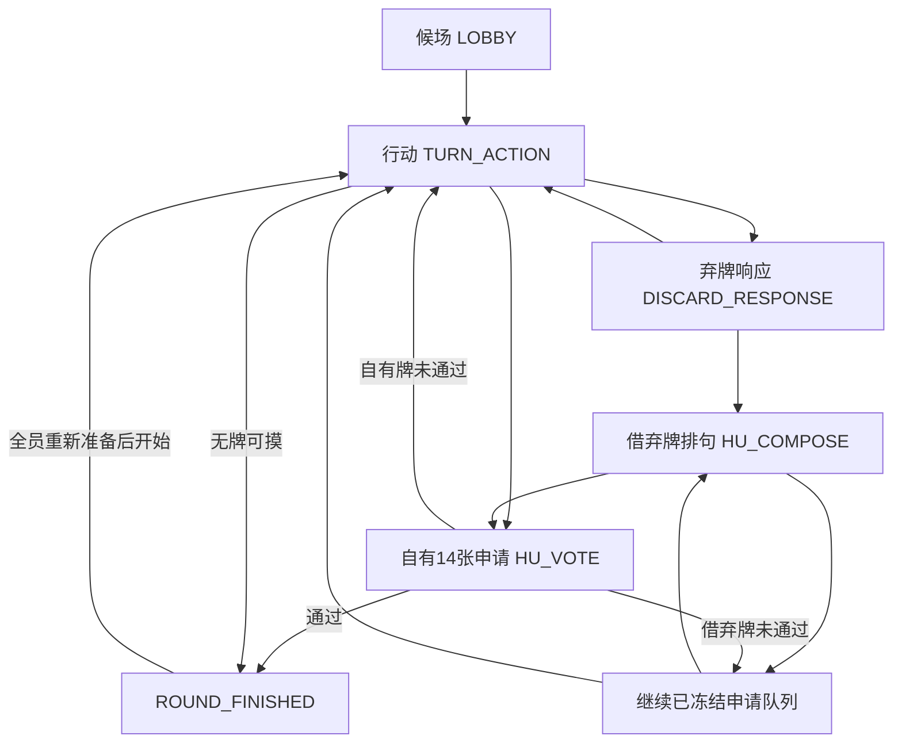

# 状态机与一致性设计

版本V1.0.0；规范依据为01-RULES。以下是实现合同，不是已完成的引擎。

## 1. 两层状态，禁止把暂停当成丢失原阶段

业务阶段 `phase`：`LOBBY | TURN_ACTION | DISCARD_RESPONSE | HU_COMPOSE | HU_VOTE | ROUND_FINISHED | ROOM_CLOSED`。

运行覆盖状态 `suspension`：`RUNNING | PAUSED_ALL_OFFLINE | PAUSED_RECOVERY | PAUSED_CLAIMANT_GRACE`。

暂停时保存原phase、phaseId、剩余时长、候选队列、牌权与尚未执行的续行任务。不能直接把phase改成“等待”后丢失从哪里继续。服务重启恢复时生成新的phaseId/控制代次，旧网络命令不能命中新阶段。

图中“继续已冻结申请队列”是服务端内部续行函数，不是重新开放8秒响应窗。不能借此让后来者补报。

## 2. 普通回合与当前弃牌

服务端房间队列原子执行：检查牌山→从牌山取一个实体牌→加入手牌→进入TURN_ACTION→写入截止时间→提交事务→发布视图。庄家首回合与吃牌回合复用同一行动阶段，但不执行抽牌。

TURN_ACTION只有当前席位可以DISCARD或DECLARE_SELF_HU。其余人可以整理自己草稿、读取快照或恢复连接，不能改变当前牌局。

DISCARD成功后写入一个唯一discardId，开启唯一responseWindowId，所有回复都引用它。弃牌响应、候选排句和候选评审期间，最新弃牌被冻结，不会被另一个正常回合覆盖。

响应登记为每个席位一个最终意向HU/EAT/PASS，重复actionId返回原应答，新的actionId企图改意向返回ALREADY_RESPONDED。超时/断线视为PASS但须保留来源，不伪称用户点击过。

只要窗口未关闭，网络先到的EAT不能提前取走牌；先等待HU机会。所有潜在响应者已提交时可以提前收窗。若存在仍有机会在8秒内恢复的原在线响应者，其未提交由截止时间处理，不因某一瞬断抢先结束窗口；窗口建立时就已离线者按PASS。

## 3. 候选排队与恢复点

窗口关闭时生成固定列表 `huQueue` 与可选 `reservedEat`，按逻辑座次排序。候选记录 `origin`：

- `SELF`：拥有14张，失败/撤回后回到本人的出牌阶段，必须弃牌；同一机会不能再次申胡。
- `DISCARD`：本人的13张+被冻结弃牌引用；失败/撤回后继续下一候选，再执行原EAT或正常摸牌。

每个候选必须保存续行上下文，不依赖浏览器重构。候选句子提交并进入HU_VOTE后不可再修改；提案版本就是冻结的orderedTileIds与commaAfterTileIds。

轮到一个排队候选前重验当前控制状态：HUMAN进入排句，BOT直接撤回；处于DISCONNECTED_GRACE则最多等待已有graceEndsAt的剩余时间，不能重新启动15秒。兑现预留EAT时只接受仍在线HUMAN；否则取消该EAT，进入正常摸牌路径。不得让AI继承之前真人登记的吃牌/胡牌。

自有牌评审占用时间不从原60秒思考时间扣除。被否决/撤回返回强制弃牌阶段时，重新给30秒弃牌时间；UI提示“本次申请未通过，请出一张牌”。这是恢复阶段固定时间，不是又获得一次申胡机会。此数值需同步defaults中的postHuDiscardMs。

HU_COMPOSE允许本人WITHDRAW_DISCARD_HU主动放弃，等价于该候选撤回；投票开始后不能用此命令改句。借弃牌的14字candidateDraft与普通13张hand draft独立保存、独立版本控制；只有当前候选阶段可写candidateDraft，按该来源的13+1验证，结束后清理，不能把引用牌变成实际手牌。

## 4. 投票结算

以进入HU_VOTE时的连接/控制快照确定eligibleReviewerIds；申请人排除，BOT和DISCONNECTED_GRACE排除。m与T一旦固定不再减少。没有评审者不亮牌、不开始投票。

收到APPROVE/REJECT时同时验证proposalId、phaseId、评审成员资格、当前控制代次、未投过、选区约束及服务端截止时间。首版不在达到多数时提前结束，等全部提交或投票截止后统一揭示。

截止原子结算：赞成数>=T且候选申请人当前可获胜（不是离线待撤回/AI）→胜利；否则未通过或申请撤回。已确定结果的proposalId之后再到的票返回已结束，不再改变计分。

异议按冻结句子中的字符位置存储，[start,endExclusive)，不按字符串查找。公开结算只提供匿名选区的并集与合并后的区间，不提供每字次数或逐票映射。私有server日志不得直接传给浏览器，不能在客户端先拿到身份映射再靠CSS隐藏。

## 5. 时间与并发裁决

所有业务时间以服务端为准。客户端倒计时仅展示serverNow与deadline的差值；不通过本机系统时间判定命令是否合法。服务端以进入房间队列时的receivedAt标记命令；截止之前到达并排队的合法动作先于相应截止事件处理，截止点采用 `receivedAt < deadline`，等于截止即已超时。

每个房间一个串行命令队列。跨房间可独立处理；同房间绝不让AI定时器、玩家消息、恢复消息直接各自改共享对象。定时任务按作用范围校验：阶段截止携带roundId/phaseId；BOT_DISCARD另带controlEpoch；GRACE_END按playerId/controlEpoch/graceEndsAt验证，不受回合phase变化影响；RETENTION_END按暂停实例及expiresAt验证。不能把所有定时器都绑死在旧phaseId，否则别人打完一轮后离线者可能永远不转AI。所有旧任务无操作退出。

不同版本号解决不同问题：

| 标识 | 负责解决 |
|---|---|
| actionId | 同一命令网络重试只执行一次 |
| stateVersion | 状态快照排序；过时公共视图不能覆盖新视图 |
| phaseId | 防止上一回合/上一投票的迟到动作命中新阶段 |
| responseWindowId / proposalId | 确认动作属于哪张弃牌/哪句申胡 |
| controlEpoch | 防止旧设备与旧AI在玩家恢复后继续操作 |

expectedStateVersion由客户端带入，但**不能对并发投票和响应一律要求等于最新全局版本**。否则第一个人的投票一更新版本，其余人从同一画面发来的票全部被误拒。HU_VOTE/响应登记用phase与对象ID、成员资格、一次性动作规则门控；行动出牌可严格检测手牌/行动版本。具体命令允许列表见contracts。

## 6. 掉线、AI与手动恢复优先级

连接断开→DISCONNECTED_GRACE(15秒)。若是当前行动者，其代出最早时刻为该缓冲结束；否则不冻结别人的正常行动。若是当前申胡申请人，业务进入PAUSED_CLAIMANT_GRACE，最多等15秒；到期仍未恢复则撤回候选，AI不得继承其成功机会。

申请人缓冲暂停时，投票/排句的剩余时间冻结，其他人只读；申请人及时恢复后重开剩余时长（至少10秒）。评审者断线则不暂停评审阶段，分母仍冻结，符合资格者可在截止前回来投票。

恢复命令与AI动作串行，两个合法时序都需要测试：

1. 恢复先提交：controlEpoch递增，旧AI任务失效；玩家看到尚未代出的14张，正常出牌。
2. AI先提交：该牌已经打出并可能进入响应窗；恢复返回新快照，玩家不能撤销该动作、再摸一张或补出另一张。

简单AI输入只包括自己可见信息，输出一个合法弃牌ID。可以使用“重复字优先→连接权重低优先→可重放随机打破平局”的轻量策略。它不是大模型，不调用API，不需要模型密钥。程序层面不向AI策略开放HU/EAT/VOTE命令，即使策略bug也必须被引擎拒绝。

## 7. 全员离线、进程重启

真人在线数降到0时，PAUSED_ALL_OFFLINE冻结业务时间，15秒接管状态与24小时保留时钟继续计算。暂停期间不继续抽牌；服务端保存暂停原因、原phase、remainingMs、待处理的申请人撤回事项。原玩家回来时先执行已到期的候选撤回，再恢复可进行的阶段；不会把已过15秒的离线胡牌重新判为获胜。

服务重启从快照恢复为PAUSED_RECOVERY，所有旧socket与内存timer失效。玩家回来才恢复业务，其他原席位从新的15秒宽限开始；每次只构造一个当前阶段定时器。恢复不重复洗牌、发牌、摸牌、记分。超过原24小时保留期限仍按过期处理，重启不能刷新保留期限。

统一resume门控顺序：过期检查→到期的申请人撤回待办→在线数检查→当前申请人presence检查→恢复业务。申请人为GRACE时，即使某位评审先回来，也仍暂停到该申请人原截止；申请人为BOT则撤回；只有申请人HUMAN或不存在当前申胡时才RUNNING。重启给的新15秒只初始化一次，不能被第二个回来的人再次刷新。LOBBY/ROUND_FINISHED不启用AI：离线15秒释放座位和准备状态，身份与历史仍保留。

## 8. 存储与广播原子边界

推荐一次SQLite事务写入：有效动作/事件、完整server快照、stateVersion、动作幂等应答、必要的胜局计分。提交成功后才广播。

- 写入失败：返回可重试错误，不广播看似成功的出牌。
- 写入成功、广播丢失：客户端重连拿快照；重试actionId取得同一应答。
- 事务提交后进程退出：恢复已提交状态，不再执行一次。
- 私人草稿可以独立版本节流保存，不让每次拖字都推动全桌公共stateVersion。

随机数种子与剩余牌山只能保存在server存储/测试夹具，不能公开给玩家。开发可用固定seed复现，生产用安全随机初始化；不能把生产seed输出到公共诊断页。

## 9. 实现必须断言的牌数

发牌：总数=13N+1，庄14、其余13。正常摸牌/吃牌：只有一个行动者14，其余13。弃牌响应：所有人13。借弃牌排句/投票：申请人仍13，候选14只是引用。自有牌投票：申请人14。ROUND_FINISHED允许保持上述原始归属，只用胜利快照展示结果。

每次引擎transition后断言实体牌数守恒、归属不重叠、唯一活动阶段、无负牌山、无多次结算、无AI主动申胡。UI不得通过隐藏错误计数来“修复”引擎。

LOBBY与ROUND_FINISHED均接受加入空座、READY和满员全准备后的START_ROUND。ROUND_FINISHED保留上一局结果供查看，同时可准备下一局，不要求一个未定义的“返回候场”命令。新局开始时分配新roundId并原子重置活动牌局，上一局结果不可覆盖。关闭/回收已终局房间只能变ROOM_CLOSED，不能把旧WIN改成EXPIRED。
